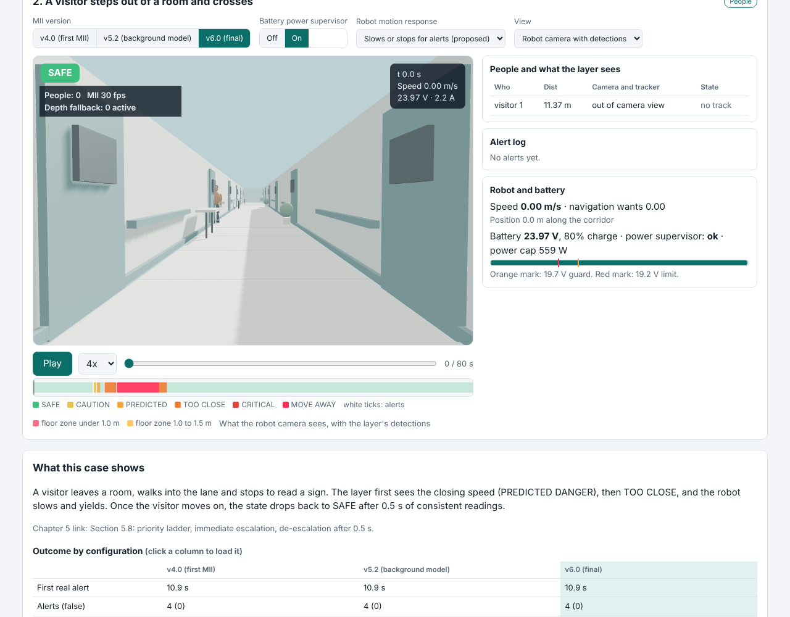
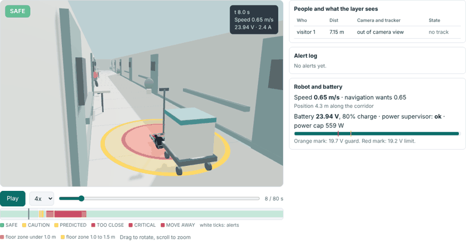
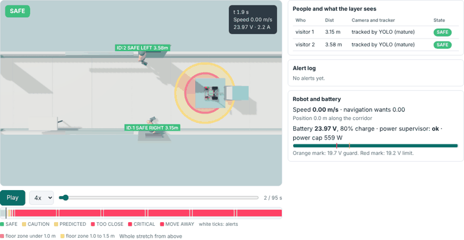
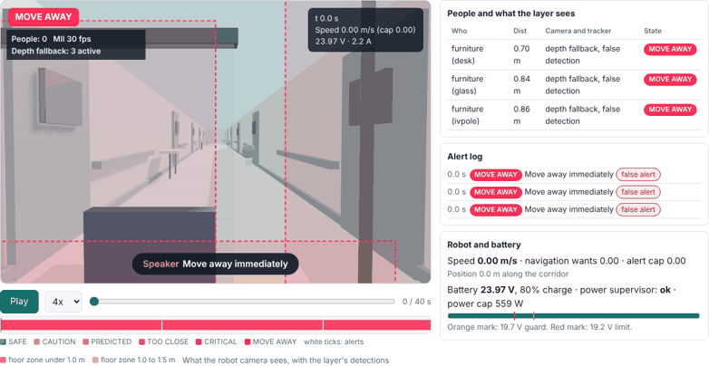

# Robotic Championship: ward deployment cases

Team Genesis, University of Malta. Interactive demo of how a hospital trolley robot behaves around people, using the Chapter 5 people-aware safety layer (MII) together with a battery power supervisor.

**Run it:** open [`index.html`](https://github.com/hypdlee/robotic-championship/blob/main/index.html), click the download icon (top right of the file view), then open the saved file in any browser. No server or install needed. (GitHub shows HTML files as code, so it cannot run the page itself.)

## What it shows

Eleven scripted ward situations, each runnable on three versions of the safety layer (v4.0, v5.2, v6.0) and on two sensor layouts (the current mast camera, and the proposed front LiDAR at 0.29 m with the camera lowered to 1.0 m):

1. Staff and patients standing in the corridor
2. A visitor steps out of a room and crosses
3. Two visitors crowd the robot at the lift lobby
4. Ghost alerts on a desk, glass partition and IV pole
5. A nurse is already standing there when the robot boots
6. The person has left but the alert stays
7. Night ward: the camera cannot see
8. Slow computer: the model runs at 0.5 frames per second
9. Heavy trolley, low battery and three pedestrian stops
10. Side approach: a visitor steps out of a door beside the robot (LiDAR add-on)
11. A parked bed blocks half the corridor: SLAM map and a detour (LiDAR add-on)

Each case has a 3D ward view (follow, robot camera with detections, overhead), the danger state and spoken or visual alerts, an alert log with false alerts tagged, a timeline you can scrub, and a pass or fail acceptance test. The floor zones around the robot mark 1.0 m (MOVE AWAY) and 1.5 m (TOO CLOSE).

| Visitor approaches | Two visitors at 0.78 m | Ghost alerts in v4.0 |
|---|---|---|
|  |  |  |

## Sensor layout

The page opens with the proposed layout, measured against the Genesis CAD: LiDAR at the front centre on a 90 mm riser (scan plane 0.29 m, 316 degrees clear, only the trolley blocks the rear 44 degrees) and the depth camera on a short braced post at 1.0 m, tilted 12 degrees down. The page shows the scan, the map built from it, the planned path and what each case gains.

## Read this before relying on it

- These are simulations driven by the chapter's rules, not recordings or real detector output.
- Only the distance and speed rules of the danger ladder (Table 5.1) are modelled. The YOLO detector, the intent classifier and the facing check are not.
- The LiDAR layout, the map, the planner and slowing the robot in response to alerts are proposed extensions. The chapter's layer only warns. The page has a switch for alerts-only.
- Assumed here, not from the chapter: 1.5 s prediction horizon, CAUTION only within 3 m, an 80 degree camera view, and the speed caps used when the robot responds.

## Files

- `index.html`: the whole demo in one file (also at `deployment-cases/deployment-cases.html`)
- `media/`: preview images and animations used in this README
- `deployment-cases/src/`: page template, simulation core (`cases_core.js`) and battery core (`core.js`)

`build.sh` inlines three.js, the Genesis CAD data and both cores into the single HTML. It expects those inputs at the paths set inside it, which are not in this repo.

## Turn on the live demo

Repo Settings, Pages, Source: Deploy from a branch, Branch: `main`, folder `/ (root)`. The page then runs at https://hypdlee.github.io/robotic-championship/ within a minute or two. That link only works after Pages is enabled.
